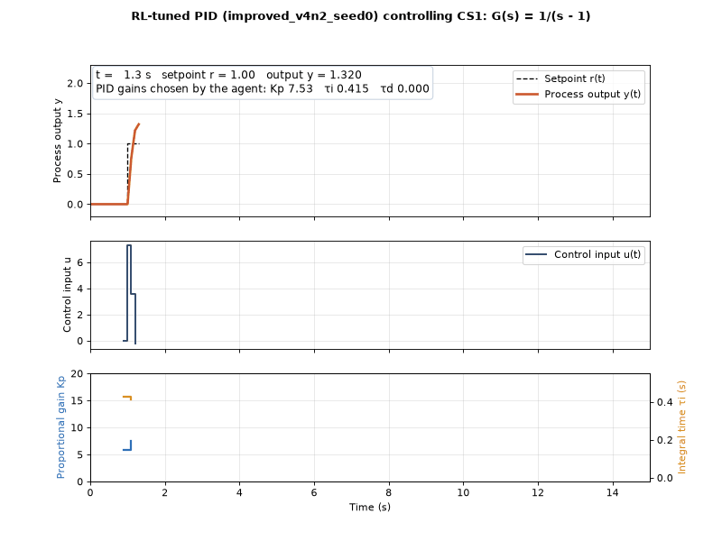

# RL_PID — Reinforcement-learning-tuned PID control of an unstable process

A PPO agent adjusts the gains of a PID controller **online** to control the open-loop unstable
process **G(s) = 1/(s − 1)**. The project reproduces and improves the m-PPO RL-PID of
T. Shuprajhaa, S.K. Sujit and K. Srinivasan, *"Reinforcement learning based adaptive PID controller
design for control of linear/nonlinear unstable processes"*, Applied Soft Computing 128 (2022) 109450.



## Result

The final version (**improved_v4n2**) beats the authors' trained agent on all four step-test
metrics, for each of its 3 training seeds and on average:

| Step test 0 → 1 | Overshoot | Settling (2 %) | ISE | IAE |
|---|---|---|---|---|
| Authors' agent | 57.8 % | 1.70 s | 0.142 | 0.266 |
| **improved_v4n2 (mean of 3 seeds)** | **32.0 %** | **1.37 s** | **0.127** | **0.256** |

Full results, robustness tests and the story of all seven reward versions: [REPORT.md](REPORT.md).

## How it works

```
             setpoint r                      control input u
  r(t) ──►  ┌──────────┐   e = r − y   ┌─────┐  ──────────►  ┌─────────────┐ ──► y(t)
            │ PPO agent│ ── Kp,τi,τd ─► │ PID │               │ G(s)=1/(s−1)│
            └──────────┘               └─────┘  ◄──────────  └─────────────┘
                 ▲          sees: r, y now, y one sample ago        │
                 └──────────────────────────────────────────────────┘
```

Every 0.2 s the agent chooses new PID gains; the PID then controls the process with them.
The agent was trained with a reward that punishes the tracking error, extra-punishes overshoot
and makes crashing (output running away) the worst possible outcome.

## Project structure

```
core/         pid.py         the PID controller
              versions.py    the 7 reward versions (one table) and the slider -> gain mapping
              env.py         the training / test environment (works for every case study)
              tools.py       loading agents, the step test, scoring, saving results
cases/        cs1.py         case study 1: G(s) = 1/(s - 1)
              cs2.py         case study 2: template, to be filled in
tests/        test_cs1.py    automatic checks of the measured results
runs/cs1/     the 19 trained agents (<version>_seed<N>/)
results/      every table and plot the scripts produce
train.py  grid_search.py  evaluate.py  robustness.py  plot_all_agents.py  live_demo.py
```

## Setup (Windows, Python 3.14)

```
git clone https://github.com/RishitheB0T/RL_PID.git
cd RL_PID
python -m venv .venv
.venv\Scripts\python.exe -m pip install -r requirements.txt
```

`run.bat` then runs every script with that environment.

## Usage (PowerShell, from the project folder)

```
.\run grid_search.py cs1                          # best fixed-gain PID (baseline), ~15 s
.\run evaluate.py cs1                             # results table + plot, ~10 s
.\run robustness.py cs1                           # sensor noise and model mismatch, ~15 s
.\run plot_all_agents.py cs1                      # all step responses in one graph
.\run live_demo.py cs1 improved_v4n2_seed0        # watch an agent live (keys: Up/Down, d, space, n)
.\run live_demo.py cs1 improved_v4n2_seed0 --gif demo.gif
.\run train.py cs1 improved_v4n2 3                # train a new agent, ~8 min
.\run -m unittest discover tests                  # check that everything still works
```

Reward versions: `paper`, `improved`, `improved_v2`, `improved_v3`, `improved_v4`,
`improved_v4n`, `improved_v4n2` (final) — see `core/versions.py`.

## Adding another case study

`cases/cs2.py` has the same layout as `cases/cs1.py` with the process and its settings left
blank. Fill in every line marked `TODO` (name, sample time, limits, setpoints and the `Process`
class), then run the same commands with `cs2`. Until then the scripts list what is still missing.

## Author

Rishikesh Kallapally — B.Tech final-year project (Electronics and Instrumentation Engineering).
