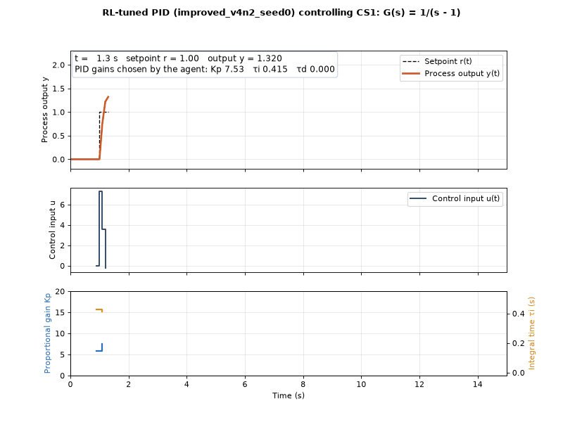
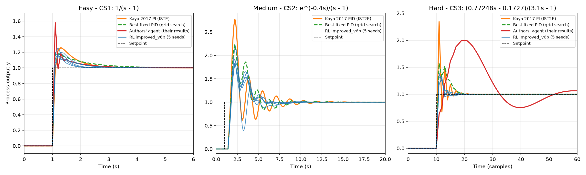
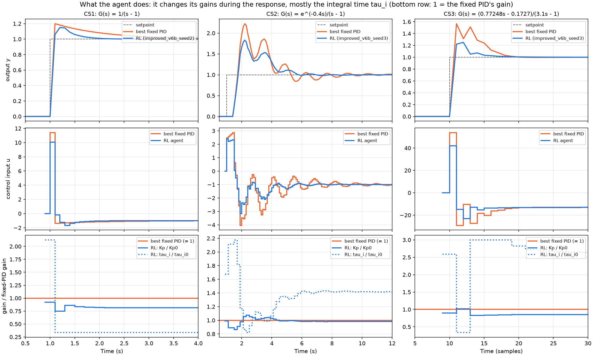

# RL_PID — Reinforcement-learning-tuned PID control of unstable processes

A PPO agent adjusts the gains of a PID controller **online** to control open-loop unstable
processes, from **G(s) = 1/(s − 1)** to a process with dead time and the authors' hardest case. The project reproduces and improves the m-PPO RL-PID of
T. Shuprajhaa, S.K. Sujit and K. Srinivasan, *"Reinforcement learning based adaptive PID controller
design for control of linear/nonlinear unstable processes"*, Applied Soft Computing 128 (2022) 109450.



## Result: three unstable processes, easy to hard

The final version, **improved_v6b**, was tested on three open-loop unstable processes.
Before training, the targets were fixed: beat every **published tuning rule** (Kaya 2017) on all
four metrics, the **authors' trained agents** on all four metrics, and the **best fixed PID** (a grid
search tuned on the test itself) on ISE and IAE. Step test 0 → 1, mean of 5 training seeds:

| Process | Controller | Overshoot | Settling (2 %) | ISE | IAE |
|---|---|---|---|---|---|
| **Easy** CS1: 1/(s − 1) | best published rule (per metric) | 25.9 % | 1.40 s | 0.131 | 0.288 |
| | authors' agent | 57.8 % | 1.70 s | 0.142 | 0.266 |
| | best fixed PID | 19.9 % | 2.50 s | 0.122 | 0.310 |
| | **improved_v6b** | **19.4 %** | **1.20 s** | **0.112** | **0.204** |
| **Medium** CS2: e^(−0.4s)/(s − 1) | best published rule (per metric) | 171.4 % | 10.40 s | 2.531 | 2.935 |
| | best fixed PID | 122.6 % | 9.60 s | 1.933 | 2.678 |
| | **improved_v6b** | **92.5 %** | **6.88 s** | **1.332** | **2.070** |
| **Hard** CS3 (authors'): (0.77248s − 0.1727)/(3.1s − 1) | best published rule (per metric) | 134.4 % | 10.0 | 3.210 | 3.609 |
| | authors' agent | 99.7 % | 58.0 | 11.266 | 17.785 |
| | best fixed PID | 56.7 % | 9.0 | 1.844 | 3.179 |
| | **improved_v6b** | **33.1 %** | **6.2** | **1.174** | **1.727** |

- Every target is met on average for all three processes.
- Every seed passes every target on CS2 and CS3 (5 of 5). On CS1, 3 of 5 seeds pass; the other two settle in 1.5 and 1.6 s.
- CS3 times are in samples (dt = 1).



What made it work:
- **Start from a good controller:** the gains are anchored on the best fixed PID.
- **Explore close to it.**
- **Choose the checkpoint on validation tests**, never on the final test.

**Beyond the step test** (REPORT.md Sections 8.7–8.9):

| Analysis | Result for improved_v6b |
|---|---|
| 200 random processes (±20 %, sensor noise) | lowest median and 90th-percentile ISE on all three processes; never ran away |
| Operating envelope (process changes up to ±40 %) | works in about as many cells as the best fixed PID, with a lower ISE in 161 of the 171 cells where both work |
| Control effort | moves the actuator less than the best fixed PID on all three processes |
| What it learned | it changes mostly the integral time during the response, which a fixed PID cannot do |



[REPORT.md](REPORT.md) covers the rest:
- robustness to noise and model mismatch;
- a load-disturbance test and new setpoint changes, including where the agents are weaker;
- the earlier CS1 result (improved_v4n2, which beats the authors' agent on all four metrics);
- the story of every reward version.

## How it works

```
             setpoint r                      control input u
  r(t) ──►  ┌──────────┐   e = r − y   ┌─────┐  ──────────►  ┌─────────────┐ ──► y(t)
            │ PPO agent│ ── Kp,τi,τd ─► │ PID │               │ G(s)=1/(s−1)│
            └──────────┘               └─────┘  ◄──────────  └─────────────┘
                 ▲          sees: r, y now, y one sample ago        │
                 └──────────────────────────────────────────────────┘
```

Every 0.2 s the agent chooses new PID gains; the PID then controls the process with them.
The agent was trained with a reward that punishes the tracking error, extra-punishes overshoot
and makes crashing (output running away) the worst possible outcome.

## Project structure

```
core/         pid.py         the PID controller
              versions.py    the reward versions (one table) and the slider -> gain mapping
              env.py         the training / test environment (works for every case study)
              tools.py       loading agents, the step test, scoring, saving results
              tuning_rules.py  published PID tuning rules (Kaya 2017), the classical baselines
              validation.py  validation tests for choosing the checkpoint (never the final test)
cases/        cs1.py         case study 1: G(s) = 1/(s - 1)
              cs2.py         case study 2: G(s) = e^(-0.4s)/(s - 1)  (with dead time)
              cs3.py         case study 3: the authors' CS3, (0.77248s - 0.1727)/(3.1s - 1)
              template.py    blank template for a new case study
stm32/        the controller in C and the firmware for the STM32F4 Discovery (see stm32/README.md)
tests/        automatic checks (measured results, processes, tuning rules, v6, C code = Python)
runs/         the trained agents: runs/<case>/<version>_seed<N>/
results/      every table and plot the scripts produce
train.py  grid_search.py  evaluate.py  targets.py  robustness.py  extra_tests.py  stress_test.py
explain_agent.py  plot_three.py  plot_training.py  plot_all_agents.py  live_demo.py
```

## Setup (Windows, Python 3.14)

```
git clone https://github.com/RishitheB0T/RL_PID.git
cd RL_PID
python -m venv .venv
.venv\Scripts\python.exe -m pip install -r requirements.txt
```

`run.bat` then runs every script with that environment.

## Usage (PowerShell, from the project folder)

```
.\run grid_search.py cs1                          # best fixed-gain PID (baseline), ~15 s
.\run evaluate.py cs1                             # results table + plot
.\run targets.py cs1                              # pass/fail against the targets
.\run robustness.py cs1                           # sensor noise and model mismatch
.\run extra_tests.py cs1                          # load disturbance and new setpoint changes
.\run plot_three.py                               # the three processes in one figure
.\run stress_test.py                              # operating envelope + 200-process Monte Carlo
.\run explain_agent.py                            # the gains the agent chooses + control effort
.\run plot_training.py                            # validation score during training
.\run plot_all_agents.py cs1                      # all step responses in one graph
.\run live_demo.py cs1 improved_v6b_seed2         # watch an agent live (keys: Up/Down, d, space, n)
.\run live_demo.py cs1 improved_v6b_seed2 --gif demo.gif
.\run train.py cs1 improved_v6b 5 1000000 --select   # train a new agent, ~35 min
.\run -m unittest discover tests                  # check that everything still works
```

Use `cs2` or `cs3` instead of `cs1` for the other case studies.

Reward versions: `paper`, `improved`, `improved_v2`, `improved_v3`, `improved_v4`,
`improved_v4n`, `improved_v4n2` (earlier final for CS1), `improved_v5` (gain ranges chosen per
case study), `improved_v6` (gains anchored on the best fixed PID), **`improved_v6b`** (final, all
three processes) and `improved_v6c`. See `core/versions.py`.

## Running on an STM32F4 (ARM Cortex-M4)

The trained controller also runs on an **STM32F407G-DISC1** board: the neural network, the PID
and a simulated process all run on the microcontroller (a real process can be connected through
the DAC and ADC). The C code gives the same step-test results as Python. See
[stm32/README.md](stm32/README.md).

```
.\run stm32\export_agent.py cs1 improved_v6b_seed2      # agent -> C header
.\run stm32\verify_on_pc.py cs1 improved_v6b_seed2      # C code vs Python, on the PC
stm32\build.bat                                         # build the firmware
stm32\flash.bat                                         # write it to the board
```

## Adding another case study

Copy `cases/template.py` to `cases/cs4.py`. It has the same layout as `cases/cs1.py`, with the
process and its settings left blank. Fill in every line marked `TODO` (name, sample time, limits,
setpoints and the `Process` class), then run the same commands with `cs4`. Until then the scripts
list what is still missing. For improved_v6b, run `grid_search.py` first and copy its best fixed
PID into `ANCHOR_PID`.

## Author

Rishikesh Kallapally — B.Tech final-year project (Electronics and Instrumentation Engineering).
