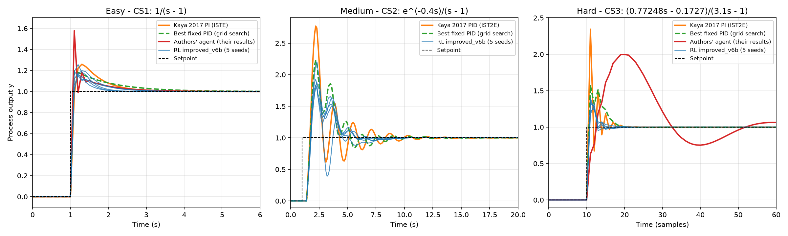
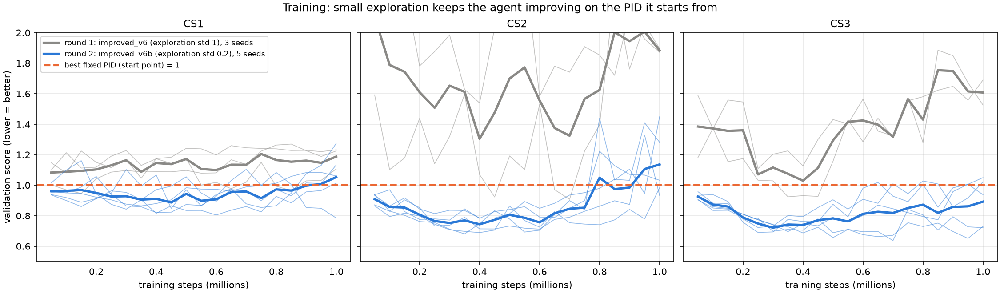
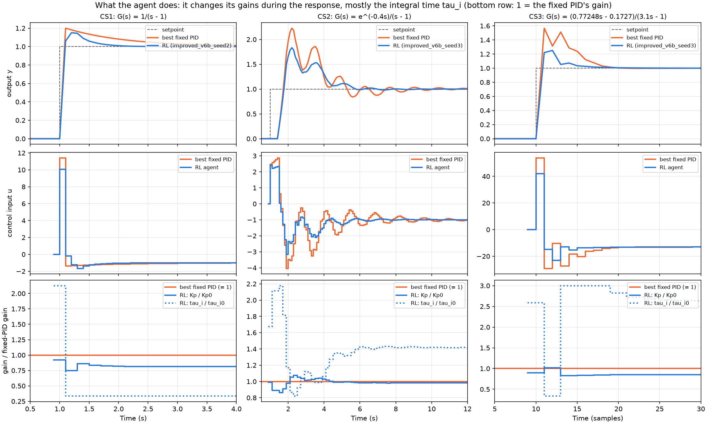
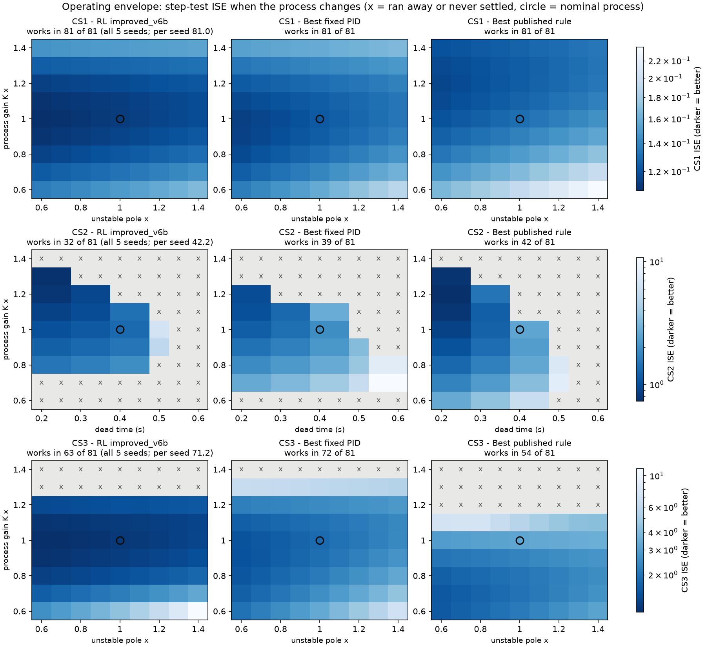
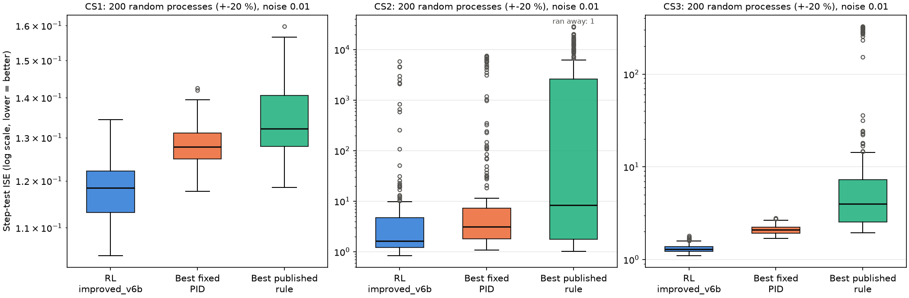

# RL-tuned PID for an open-loop unstable process — results

**Project:** B.Tech final-year project. Reproduction and improvement of the m-PPO RL-tuned PID of Shuprajhaa, Sujit and Srinivasan, *Applied Soft Computing* 128 (2022) 109450.

**Case studies:**

| Case | Process | Sample time |
|---|---|---|
| CS1 (easy) | G(s) = 1/(s − 1) — Sections 1–6 | 0.1 s |
| CS2 (medium) | G(s) = e^(−0.4s)/(s − 1), the same unstable pole with 0.4 s dead time — Section 7 | 0.1 s |
| CS3 (hard) | the authors' CS3, G(s) = (0.77248 s − 0.1727)/(3.1 s − 1) — Section 8 | 1 |

Section 8 also holds the three-process study: targets fixed before training (published tuning
rules, the authors' agents, the best fixed PID) and the final method **improved_v6b**, which meets
every target on average for all three processes. Section 9 covers running the controller on an
STM32F4 microcontroller.

All numbers below were measured by running this code:
- **Step-test and robustness numbers:** `results/cs1_*.txt`, `results/cs2_*.txt` and `results/cs3_*.txt`.
- **Training figures:** the training logs (`runs/<case>/*/train_log.txt` or `log.txt`, `0.monitor.csv`
  and, for improved_v6 onwards, `validation.csv`).

---

## 1. Goal

Train a PPO agent that tunes a PID controller online for an unstable process. The aim is to beat the authors' trained agent on all four step-test metrics:

| Metric | Authors' agent |
|---|---|
| Overshoot | 57.8 % |
| Settling time (2 % band) | 1.70 s |
| ISE | 0.142 |
| IAE | 0.266 |

---

## 2. Setup

### Process, controller and agent

| Part | Setting |
|---|---|
| Process | G(s) = 1/(s − 1), simulated exactly with zero-order hold: y[k+1] = 1.105·y[k] + 0.105·u[k] |
| Controller | Positional PID: P on the error (or b·r − y), I with ±100 anti-windup, D on the measurement; control input u limited to ±100 |
| Gain formulas | Ki = Kp / (τi + 0.01), Kd = Kp·τd (the authors' formulas) |
| Agent output | 3 sliders in [−1, 1], stretched into Kp, τi, τd (a 4th slider for b in improved_v3 only) |
| Agent input | Setpoint, output now, output one sample ago |
| Action repeat | 2: new gains every 0.2 s |
| Run stops | When \|y\| > 100 ("ran away") |
| Algorithm | PPO (Stable-Baselines3 defaults: 2 × 64 tanh, lr 3·10⁻⁴, 2048 steps per update, batch 64), VecNormalize on observations and rewards, 500,000 steps |
| Training run | 1 s at setpoint 0, then 3 random setpoints in [0, 2], 20 s each |

### Step test and metrics

- **Step test:** 1 s at setpoint 0, then setpoint 1 for 20 s.
- **Overshoot:** peak above 1, in %.
- **Settling:** time after the step until the output stays within ±0.02.
- **ISE, IAE:** Σe²·Δt and Σ|e|·Δt from the step on.
- **Note on the minimum:** every controller's first sample after the step is still 0, so ISE ≥ 0.1, IAE ≥ 0.1 and settling ≥ 0.1 s for all of them.

### Software

Python 3.14.7, numpy 2.5.3, torch 2.14.0+cpu, gymnasium 1.3.0, stable-baselines3 2.9.0, matplotlib 3.11.2. All runs were on CPU.

---

## 3. The reward versions

Results are 3-seed averages (overshoot % / settling s / ISE / IAE) unless marked 1 seed.

| Version | Change | Reason | Result |
|---|---|---|---|
| **paper** | The authors' reward: −min(0.01e², 5) + bonus | Reproduction | 55.4 / 2.23 / 0.143 / 0.291. Behaves like the authors' agent: high Kp, first-sample spike. |
| **improved** | Error penalty 10e², cap 5000 | Overshoot cost almost nothing | Seeds 0 and 1 good (33.9 % and 13.7 % overshoot). **Seed 2 learned to crash on purpose.** |
| **improved_v2** | + crashing costs −5000 for every step left | Close the crash loophole | No seed collapsed. 13.7 / 3.43 / 0.113 / 0.318: low overshoot, slow settling. |
| **improved_v3** | + setpoint weight b as a 4th slider | Softer first push | Seeds inconsistent. 13.5 / 3.80 / 0.175 / 0.491 |
| **improved_v4** | v2 + overshoot penalty 100·ov² | Punish going past the setpoint | 1 seed: 16.0 / 3.70 / 0.123 / 0.378 |
| **improved_v4n** | v4 + τi 0.05–1.0, τd 0–0.2 | All v2 agents and 2 of 3 v3 agents pinned τi at 2.0 | 21.8 / 2.13 / 0.123 / 0.289. Beats the authors on 2 of 4 metrics. |
| **improved_v4n2** | v4n + τi 0.05–0.5 | Fixed-gain check: τi = 0.5 with Kp 9–12.5 beats the authors on all four | **32.0 / 1.37 / 0.127 / 0.256. Beats the authors on all four.** |
| **improved_v5** | v4 reward + gain ranges chosen per case study from its fixed-gain check | v4n2's ranges contain no stable PID for CS2 | On CS1 identical to improved_v4n2 (same ranges). On CS2 the only working version (Section 7). |
| **improved_v6** | Gains anchored on the best fixed PID (slider 0 = that PID) + bonus 1 per sample inside the 2 % band + checkpoint chosen on validation tests | Start from a good controller; push settling | Round 1 of Section 8: no seed met every target; the agents drifted away from the anchor PID. |
| **improved_v6b** | v6 + small starting exploration (std 0.2 instead of 1) | Explore near the anchor | **Final version for all three processes (Section 8):** CS1 19.4 / 1.20 / 0.112 / 0.204 (5 seeds). Meets every target on average for CS1, CS2 and CS3. |
| **improved_v6c** | v6b + band bonus 5 | Push the CS1 settling time | CS1 only: 22.4 / 1.14 / 0.117 / 0.216, 3 of 5 seeds pass (as v6b). |

An earlier try with the improved reward capped at 5 (instead of 5000) also learned to crash on purpose: ep_len_mean 4.52, test overshoot 10037.5 %. It is not one of the versions in the table.

---

## 4. Step-test results (all agents)

From `results/cs1_evaluate.txt`. "Beats" means better than the authors' agent on all four metrics. improved_v3 is left out here; it is in Section 6. The baseline row is explained below the table.

| Controller | Overshoot % | Settling s | ISE | IAE | Completed | Beats authors |
|---|---|---|---|---|---|---|
| Classical PI (Kp 3, τi 1.25) | 48.8 | 4.00 | 0.401 | 0.914 | yes | no |
| Best fixed PID (Kp 10.5, τi 1.15, τd 0) | 19.9 | 2.50 | 0.122 | 0.310 | yes | no |
| paper seed 0 / 1 / 2 | 67.9 / 46.6 / 51.6 | 2.00 / 2.30 / 2.40 | 0.162 / 0.129 / 0.136 | 0.296 / 0.279 / 0.298 | yes | no |
| improved seed 0 / 1 | 33.9 / 13.7 | 2.80 / 3.10 | 0.120 / 0.109 | 0.296 / 0.284 | yes | no |
| improved seed 2 | 10037.5 | 0.80 | 2476.529 | 35.928 | **no** (ran away) | no |
| improved_v2 seed 0 / 1 / 2 | 13.2 / 15.7 / 12.2 | 3.50 / 3.40 / 3.40 | 0.114 / 0.112 / 0.113 | 0.328 / 0.309 / 0.317 | yes | no |
| improved_v4 seed 0 | 16.0 | 3.70 | 0.123 | 0.378 | yes | no |
| improved_v4n seed 0 / 1 / 2 | 21.4 / 24.9 / 19.1 | 2.20 / 2.20 / 2.00 | 0.121 / 0.133 / 0.114 | 0.292 / 0.323 / 0.253 | yes | no |
| **improved_v4n2 seed 0** | **32.0** | **1.30** | **0.128** | **0.255** | yes | **yes** |
| **improved_v4n2 seed 1** | **31.5** | **1.40** | **0.129** | **0.260** | yes | **yes** |
| **improved_v4n2 seed 2** | **32.5** | **1.40** | **0.126** | **0.252** | yes | **yes** |
| Authors' agent (their files) | 57.8 | 1.70 | 0.142 | 0.266 | – | – |

The best fixed PID is the gain set with the smallest ISE found by `grid_search.py` (Kp 0–20 in steps of 0.5, τi and τd 0–2 in steps of 0.05). It was tuned on this test.

**Averages per version (3 seeds):**

| Version | Overshoot % | Settling s | ISE | IAE | Beats authors |
|---|---|---|---|---|---|
| paper | 55.4 | 2.23 | 0.143 | 0.291 | no |
| improved | 3361.7 | 2.23 | 825.586 | 12.170 | no |
| improved_v2 | 13.7 | 3.43 | 0.113 | 0.318 | no |
| improved_v4n | 21.8 | 2.13 | 0.123 | 0.289 | no |
| **improved_v4n2** | **32.0** | **1.37** | **0.127** | **0.256** | **yes** |

**Gains chosen by the final agents (median over the test):**

| improved_v4n2 | Kp | τi | τd |
|---|---|---|---|
| seed 0 | 9.99 | 0.485 | 0 |
| seed 1 | 8.78 | 0.500 | 0 |
| seed 2 | 9.47 | 0.500 | 0 |

Plots: `results/cs1_comparison.png` (outputs and Kp) and `results/cs1_all_agents.png` (all agents in one graph).

---

## 5. Training summary

Every run trained for 500,000 steps; a full training run is 300 moves.

| Version | Seed | Final ep_len_mean | Final ep_rew_mean | Training time |
|---|---|---|---|---|
| paper | 0 / 1 / 2 | 300 / 300 / 300 | 1060.6* / 1010 / 1050 | 444* / 486 / 478 s |
| improved | 0 / 1 / 2 | 300 / 300 / **4.9** | −158.1* / 844 / −31,500 | 503* / 531 / 491 s |
| improved_v2 | 0 / 1 / 2 | 300 / 300 / 300 | 830 / −66,400 / 921 | 510 / 553 / 758 s |
| improved_v3 | 0 / 1 / 2 | 300 / 300 / 300 | 782 / 789 / −8,990 | 625 / 631 / 633 s |
| improved_v4 | 0 | 300 | 784 | 402 s |
| improved_v4n | 0 / 1 / 2 | 300 / 300 / 300 | 337 / 115 / −581 | 401 / 398 / 394 s |
| improved_v4n2 | 0 / 1 / 2 | 300 / 300 / 300 | −483 / 783 / 937 | 495 / 542 / 1330 s |

\* paper seed 0 and improved seed 0 were trained in the first session without a saved log. Their reward is the mean of the last 100 episodes in `0.monitor.csv`, and their time is the monitor's elapsed time.

- **Collapse:** only improved seed 2 collapsed (ep_len_mean 4.9 = crashing on purpose).
- **Negative final rewards in some normal runs** (for example improved_v2 seed 1 and improved_v4n2 seed 0) come from a few very bad full-length exploration episodes, not from crashes. Their last-100 medians were 935.1 and 885.4.

---

## 6. Robustness (no re-training, no re-tuning)

From `results/cs1_robustness.txt`.

- **Scenarios:** sensor noise (σ = 0.01 and 0.05, 10 noise seeds each, scored on the true output) and model mismatch (G(s) = K/(s − a) with a = 0.8 or 1.2, or K = 0.8 or 1.2).
- **Groups:** RL rows are the mean of 3 seeds. Every run of these groups completed.
- **Best fixed 2-DOF PID:** the grid search over setpoint weight b as well (Kp 10.5, τi 1.80, b 0.85). It was also tuned on the nominal test.

**ISE**

| Group | nominal | noise 0.01 | noise 0.05 | a = 0.8 | a = 1.2 | K = 0.8 | K = 1.2 |
|---|---|---|---|---|---|---|---|
| paper | 0.143 | 0.157 | 0.473 | 0.140 | 0.146 | 0.118 | 2.660 |
| improved_v2 | 0.113 | 0.120 | 0.253 | 0.110 | 0.117 | 0.122 | 0.118 |
| improved_v3 | 0.175 | 0.198 | 0.721 | 0.177 | 0.174 | 0.180 | 222.691 |
| **improved_v4n2** | 0.127 | 0.131 | 0.201 | 0.124 | 0.131 | 0.144 | 0.120 |
| Classical PI | 0.401 | 0.404 | 0.429 | 0.330 | 0.497 | 0.596 | 0.304 |
| Best fixed PID | 0.122 | 0.126 | 0.199 | 0.118 | 0.127 | 0.130 | 0.130 |
| Best fixed 2-DOF PID | 0.100 | 0.104 | 0.171 | 0.100 | 0.100 | 0.105 | 0.105 |

**IAE**

| Group | nominal | noise 0.01 | noise 0.05 | a = 0.8 | a = 1.2 | K = 0.8 | K = 1.2 |
|---|---|---|---|---|---|---|---|
| paper | 0.291 | 0.620 | 2.096 | 0.279 | 0.303 | 0.285 | 4.366 |
| improved_v2 | 0.318 | 0.512 | 1.473 | 0.289 | 0.346 | 0.381 | 0.299 |
| improved_v3 | 0.491 | 0.879 | 2.691 | 0.487 | 0.495 | 0.514 | 38.195 |
| **improved_v4n2** | 0.256 | 0.427 | 1.138 | 0.248 | 0.264 | 0.299 | 0.226 |
| Classical PI | 0.914 | 0.985 | 1.293 | 0.803 | 1.049 | 1.271 | 0.738 |
| Best fixed PID | 0.310 | 0.466 | 1.155 | 0.288 | 0.333 | 0.346 | 0.292 |
| Best fixed 2-DOF PID | 0.101 | 0.282 | 1.010 | 0.134 | 0.135 | 0.187 | 0.168 |

**Settling time (s)** (20.00 = not settled by the end of the test)

| Group | nominal | noise 0.01 | noise 0.05 | a = 0.8 | a = 1.2 | K = 0.8 | K = 1.2 |
|---|---|---|---|---|---|---|---|
| paper | 2.23 | 19.93 | 19.99 | 2.03 | 2.30 | 2.43 | 8.13 |
| improved_v2 | 3.43 | 19.86 | 19.98 | 3.13 | 3.63 | 3.77 | 3.03 |
| improved_v3 | 3.80 | 19.94 | 19.99 | 3.77 | 3.87 | 3.90 | 9.50 |
| **improved_v4n2** | 1.37 | 19.19 | 19.99 | 1.37 | 1.37 | 1.40 | 1.27 |
| Classical PI | 4.00 | 4.79 | 19.78 | 3.00 | 4.40 | 5.10 | 2.90 |
| Best fixed PID | 2.50 | 19.33 | 19.98 | 2.40 | 2.50 | 2.60 | 2.30 |
| Best fixed 2-DOF PID | 0.10 | 19.28 | 19.98 | 0.10 | 0.40 | 1.50 | 0.70 |

**Overshoot (%)**

| Group | nominal | noise 0.01 | noise 0.05 | a = 0.8 | a = 1.2 | K = 0.8 | K = 1.2 |
|---|---|---|---|---|---|---|---|
| paper | 55.4 | 55.5 | 56.1 | 53.8 | 57.0 | 24.3 | 86.4 |
| improved_v2 | 13.7 | 13.9 | 25.5 | 12.1 | 15.4 | 16.7 | 28.9 |
| improved_v3 | 13.5 | 15.9 | 39.6 | 12.6 | 14.5 | 15.4 | 212.8 |
| **improved_v4n2** | 32.0 | 32.2 | 33.4 | 29.3 | 34.8 | 30.2 | 28.4 |
| Classical PI | 48.8 | 49.0 | 50.1 | 40.5 | 58.2 | 60.2 | 41.4 |
| Best fixed PID | 19.9 | 19.9 | 23.7 | 18.7 | 21.2 | 21.0 | 43.9 |
| Best fixed 2-DOF PID | 0.1 | 3.1 | 15.6 | 0.0 | 2.1 | 3.7 | 20.0 |

**What the tables show:**

- **improved_v4n2 stays fast in every mismatch scenario:** settling 1.27–1.40 s, ISE 0.120–0.144, IAE 0.226–0.299.
- **Against paper:** improved_v4n2 is better on all four metrics in 6 of 7 scenarios. At K = 0.8, paper is better on overshoot, ISE and IAE.
- **paper and improved_v3 degrade at K = 1.2:** one seed of each keeps oscillating.
- **Noise:** with sensor noise, almost every controller's 2 % settling time goes to the end of the test.
- **The best fixed 2-DOF PID**, tuned on this exact test, is better than every RL group on overshoot, ISE and IAE in every scenario.

---

## 7. Case study 2: unstable process with dead time

### The process

**G(s) = e^(−0.4s)/(s − 1):** CS1's unstable pole with a 0.4 s dead time (4 samples) added. Everything else is the same as CS1: sample time, limits, setpoints, training and rewards. The paper gives no numbers for this process, so the references are the grid-search PIDs.

### Why it is much harder (fixed-gain check)

- **Stable fixed PIDs need Kp 1.2–3.2.** CS1 tolerated Kp up to about 20.
- **Best fixed PID** on the standard grid: Kp 2.5, τi 2.0, τd 0.25, giving 142.4 % / 9.20 s / ISE 1.980 / IAE 2.587. A wider search found ISE 1.929 at Kp 2.4, τi 2.5, τd 0.26.
- **Effect of each version's gain ranges:**

  | Ranges | Best fixed PID inside them |
  |---|---|
  | improved_v4n2 (τi ≤ 0.5) | **none stable**: the best is Kp = 0, i.e. no control at all |
  | improved_v4n (τi ≤ 1) | ISE 3.884 |

- **Ranges chosen for improved_v5 on CS2:** Kp 0–5, τi 0.5–4, τd 0–0.5. They cover the good region found by the check (Kp 1.8–2.9, τi 0.75–8, τd 0.10–0.46).

### Step-test results

From `results/cs2_evaluate.txt`; improved_v3 is from the nominal row of `results/cs2_robustness.txt`. All 24 agents (8 versions × 3 seeds) completed the test without running away.

| Controller | Overshoot % | Settling s | ISE | IAE |
|---|---|---|---|---|
| improved_v5 seed 0 | 87.3 | 8.30 | 1.562 | 2.692 |
| improved_v5 seed 1 | 89.3 | 7.40 | 1.875 | 3.040 |
| improved_v5 seed 2 | 133.7 | 6.40 | 1.946 | 2.558 |
| **improved_v5 average** | **103.4** | **7.37** | **1.795** | **2.763** |
| Best fixed PID (Kp 2.5, τi 2.0, τd 0.25) | 142.4 | 9.20 | 1.980 | 2.587 |
| Best fixed 2-DOF PID (b 0.30) | 23.3 | 4.00 | 0.756 | 1.091 |
| paper average | 0.0 | 20.00 | 20.000 | 20.000 |
| improved average | 0.0 | 20.00 | 20.000 | 20.000 |
| improved_v2 average | 4693.7 | 20.00 | 11109.342 | 321.741 |
| improved_v3 average | 3848.8 | 20.00 | 6256.544 | 283.871 |
| improved_v4 average | 3909.4 | 20.00 | 6007.899 | 281.350 |
| improved_v4n average | 3860.9 | 20.00 | 7917.437 | 327.662 |
| improved_v4n2 average | 3893.8 | 20.00 | 9667.722 | 375.211 |

**What the agents learned:**
- **improved_v5** is the only version that controls CS2. Median gains: seed 0 Kp 2.45, τi 4.00, τd 0.203; seed 1 Kp 1.95, τi 4.00, τd 0.267; seed 2 Kp 2.35, τi 3.85, τd 0.192. It again uses τi at or near the top of its range.
- **paper and improved** (small −20 crash penalty) crashed in most of their training episodes (4,078–7,811 early-stopped episodes per run). They ended up giving no control input: the output stays at 0 (ISE = IAE = 20), which never crashes but never follows the setpoint either. The seed-0 agents of both use Kp = 0.
- **improved_v2, v3, v4, v4n and v4n2** (worst-case crash penalty) end in a large sustained oscillation (overshoot 3,500–5,100 %) that never crosses the ±100 limit: the run completes, but with huge errors. The two agents inspected, improved_v2 and improved_v4 seed 0, use Kp at the top of the range (median 18.97 and 20.00) and oscillate between about −42 and +45.

### Training summary

All 24 runs finished (exit code 0), taking 428–515 s each. The improved_v5 runs were the slowest because the STM32 code was being written and compiled on the same PC at the same time.

| Version | Final ep_len_mean (seed 0 / 1 / 2) | Final ep_rew_mean (seed 0 / 1 / 2) |
|---|---|---|
| improved_v5 | 300 / 300 / 295 | −4,280 / −9,460 / −62,000 |
| paper | 299 / 283 / 297 | −4.72 / −20 / −6.97 |
| improved | 297 / 292 / 292 | −7,950 / −11,400 / −15,800 |
| improved_v2 | 300 / 300 / 295 | −1.32·10⁶ / −1.28·10⁶ / −1.33·10⁶ |
| improved_v3 | 300 / 300 / 300 | −1.33·10⁶ / −1.32·10⁶ / −1.37·10⁶ |
| improved_v4 | 300 / 300 / 300 | −1.85·10⁶ / −1.93·10⁶ / −1.85·10⁶ |
| improved_v4n | 300 / 300 / 278 | −2.24·10⁶ / −2.23·10⁶ / −1.73·10⁶ |
| improved_v4n2 | 300 / 300 / 300 | −2.24·10⁶ / −2.23·10⁶ / −2.24·10⁶ |

### Robustness (group averages)

From `results/cs2_robustness.txt`. Every run of every group completed.

| ISE | nominal | noise 0.01 | noise 0.05 | delay 0.3 | delay 0.5 | K = 0.8 | K = 1.2 |
|---|---|---|---|---|---|---|---|
| **improved_v5** | 1.795 | 1.801 | 1.882 | 1.476 | 3.841 | 2.464 | 2.474 |
| Best fixed PID | 1.980 | 1.993 | 2.164 | 1.293 | 10.239 | 2.558 | 836.606 |
| Best fixed 2-DOF PID | 0.756 | 0.760 | 0.850 | 0.663 | 2.218 | 0.953 | 1.172 |

| Settling s | nominal | noise 0.01 | noise 0.05 | delay 0.3 | delay 0.5 | K = 0.8 | K = 1.2 |
|---|---|---|---|---|---|---|---|
| **improved_v5** | 7.37 | 18.56 | 19.99 | 8.30 | 15.13 | 9.77 | 16.33 |
| Best fixed PID | 9.20 | 19.63 | 20.00 | 6.80 | 20.00 | 8.90 | 20.00 |
| Best fixed 2-DOF PID | 4.00 | 19.12 | 19.97 | 4.30 | 20.00 | 6.20 | 20.00 |

| Overshoot % | nominal | noise 0.01 | noise 0.05 | delay 0.3 | delay 0.5 | K = 0.8 | K = 1.2 |
|---|---|---|---|---|---|---|---|
| **improved_v5** | 103.4 | 103.8 | 106.2 | 71.7 | 164.9 | 109.3 | 116.1 |
| Best fixed PID | 142.4 | 142.0 | 143.4 | 84.2 | 224.3 | 123.5 | 2132.1 |
| Best fixed 2-DOF PID | 23.3 | 23.9 | 29.1 | 13.5 | 70.0 | 36.2 | 34.7 |

| IAE | nominal | noise 0.01 | noise 0.05 | delay 0.3 | delay 0.5 | K = 0.8 | K = 1.2 |
|---|---|---|---|---|---|---|---|
| **improved_v5** | 2.763 | 2.863 | 3.367 | 2.655 | 4.857 | 3.405 | 4.212 |
| Best fixed PID | 2.587 | 2.725 | 3.548 | 2.103 | 11.763 | 3.255 | 88.551 |
| Best fixed 2-DOF PID | 1.091 | 1.253 | 2.021 | 1.059 | 5.135 | 1.665 | 3.347 |

**What the tables show:**
- **improved_v5 vs best fixed PID:** v5 has lower ISE in 6 of 7 scenarios (all except delay 0.3) and lower IAE in 3 of 7 (noise 0.05, delay 0.5, K = 1.2).
- **The fixed PID breaks down under mismatch:** at K = 1.2 it oscillates (overshoot 2132.1 %, ISE 836.6) and at delay 0.5 its ISE is 10.239. improved_v5 stays bounded in both (ISE 2.474 and 3.841).
- **The best fixed 2-DOF PID**, tuned on this test, has lower overshoot and ISE than improved_v5 in every scenario. improved_v5 settles sooner than it at noise 0.01, delay 0.5 and K = 1.2, and has lower IAE at delay 0.5.

---

## 8. Three processes: easy, medium, hard



*The 0 → 1 step test. Blue: the five improved_v6b agents. Orange: the best published tuning rule.
Green dashed: the best fixed PID. Red: the authors' agent, from their own result files (CS1, CS3).*

### 8.1 The processes

| Level | Process | Why it is harder |
|---|---|---|
| Easy | CS1: 1/(s − 1), dt 0.1 s | unstable pole, no dead time |
| Medium | CS2: e^(−0.4s)/(s − 1), dt 0.1 s | the same pole plus 0.4 s dead time: a P controller is only stable for about 1 < Kp < 3.3 |
| Hard | CS3 (authors'): (0.77248 s − 0.1727)/(3.1 s − 1), dt 1 | the authors' hardest case; unstable pole at 1/3.1, small gain, coarse sampling, u limited to ±100 |

`cases/cs3.py` simulates CS3 exactly as the authors' code does. Their code (python-control `tf2ss` +
`c2d`) computes the output as y = Cx only, so the direct term 0.77248/3.1 is never added, and the
process they actually simulate is c/(s − a) with a = 1/3.1 and c = 0.02467. Check: replaying the
gains the authors' agent chose, through our PID and `cases/cs3.py`, reproduces their recorded output
to within 1.3 × 10⁻¹⁵ and their control input to within 5.7 × 10⁻¹⁴ (the same holds for CS1).

### 8.2 Targets, fixed before any training

For each process, the agents must beat:

- **A. every published tuning rule, on all four metrics:** each metric must be lower than the best value that any rule reaches. The rules are Kaya, *Simple and Optimal PI/PID Tuning Formulae for Unstable Time Delay Processes*, ELECO 2017. Four rules for K e^(−θs)/(Ts − 1): PI and PID, each fitted for minimum ISTE and for minimum IST²E. `core/tuning_rules.py` reproduces the paper's worked examples to within 0.4 % (`tests/test_tuning_rules.py`).
  - θ = dead time + DT/2 (the usual allowance for the sample-and-hold). CS1: θ/T = 0.05 is below the rules' range (0.1–0.9), so 0.1 is used. CS3: K = c·T = 0.0765, T = 3.1, θ = 0.5.
  - On our discrete loops the two PID rules end in a sustained oscillation on CS1 and CS3 (their numbers are in `results/cs*_targets.txt`). The best rule is therefore a PI rule on CS1 and CS3, and the IST²E PID rule on CS2.
- **B. the authors' agent, on all four metrics** (CS1, CS3), scored from their own result files with our scoring.
- **C. the best fixed PID, on ISE and IAE.** This is the grid-search optimum, tuned on the test itself. The CS2 grid was widened (τi up to 8), because its old optimum lay on the grid edge.

| Process | A. Best rule value per metric (OS / ts / ISE / IAE) | B. Authors' agent | C. Best fixed PID (ISE / IAE) |
|---|---|---|---|
| CS1 | 25.9 % / 1.40 s / 0.131 / 0.288 | 57.8 % / 1.70 s / 0.142 / 0.266 | 0.122 / 0.310 |
| CS2 | 171.4 % / 10.40 s / 2.531 / 2.935 | – | 1.933 / 2.678 |
| CS3 | 134.4 % / 10.0 / 3.210 / 3.609 | 99.7 % / 58.0 / 11.266 / 17.785 | 1.844 / 3.179 |

The earlier CS1 final agent (improved_v4n2) beats B but not A (overshoot 32.0 % > 25.9 %) or C
(ISE 0.127 > 0.122). The published rules are much stronger than the old "Classical PI".

### 8.3 The method: improved_v6, v6b, v6c

- **Gains anchored on the best fixed PID** (`ANCHOR_PID` in the case file). Slider 0 is exactly that PID, so the untrained agent already starts as a good controller:
  - Kp = Kp₀·2^a (Kp₀/2 … 2Kp₀);
  - τi = τi₀·3^a;
  - τd = τd₀ + a·span (never below 0).
- **Reward:** as improved_v4 (error² + overshoot², worst-case crash penalty), plus a bonus for every sample inside the 2 % band of the last setpoint step. The bonus is 1 in v6 and v6b, 5 in v6c.
- **Checkpoint selection without the final test.** `train.py --select` scores the agent every 50,000 steps on three validation step tests: 0 → 0.5, 0 → 1.5 and 0.8 → 1.6. The score is the average ratio to the anchor PID over the four metrics, and the best checkpoint is kept. The final 0 → 1 test is run only at the end.
- **improved_v6b** = v6 with a small starting exploration noise (PPO log-std −1.6, std 0.2 instead of 1).
- 1,000,000 steps per run, PPO with SB3 defaults otherwise. Each run takes 70–85 min with 8 runs in parallel on one 8-core PC.

**Rounds** (the plan allowed at most three):

| Round | Version | What happened |
|---|---|---|
| 1 | improved_v6 | 0 of 7 runs passed. With exploration std 1 on sliders of −1…+1, the agents wandered away from the anchor PID: the validation score of every run ended worse than the anchor's. The remaining 8 runs were stopped. |
| 2 | **improved_v6b** | CS2 and CS3: every seed passes every target. CS1: the average passes, 3 of 5 seeds. |
| 3 (CS1) | improved_v6c | Also 3 of 5 seeds, with a slightly worse average than v6b. v6b is kept as the one method for all three processes. |

### 8.4 Results (`results/cs*_targets.txt`)

| Process | improved_v6b, average of 5 seeds (OS / ts / ISE / IAE) | A | B | C | Seeds passing every target |
|---|---|---|---|---|---|
| CS1 | 19.4 % / 1.20 s / 0.112 / 0.204 | yes | yes | yes | 3 of 5 |
| CS2 | 92.5 % / 6.88 s / 1.332 / 2.070 | yes | – | yes | **5 of 5** |
| CS3 | 33.1 % / 6.2 / 1.174 / 1.727 | yes | yes | yes | **5 of 5** |

**Every seed:**

| | seed 0 | seed 1 | seed 2 | seed 3 | seed 4 |
|---|---|---|---|---|---|
| CS1 | 19.8 / 1.50 / 0.116 / 0.233 | 17.4 / 1.60 / 0.111 / 0.220 | 15.1 / 0.90 / 0.106 / 0.164 | 19.1 / 0.90 / 0.110 / 0.184 | 25.6 / 1.10 / 0.119 / 0.218 |
| CS2 | 87.6 / 7.90 / 1.407 / 2.240 | 120.5 / 5.80 / 1.545 / 2.062 | 78.9 / 7.90 / 1.183 / 1.988 | 83.2 / 5.70 / 1.214 / 1.960 | 92.5 / 7.10 / 1.311 / 2.100 |
| CS3 | 36.4 / 6.00 / 1.196 / 1.742 | 32.0 / 8.00 / 1.188 / 1.759 | 32.1 / 5.00 / 1.136 / 1.599 | 25.1 / 7.00 / 1.122 / 1.721 | 39.8 / 5.00 / 1.228 / 1.815 |

The two CS1 seeds that fail (0 and 1) miss only one target. They settle in 1.50 s and 1.60 s,
against 1.40 s for the Kaya IST²E PI rule; their overshoot, ISE and IAE beat every target.

Compared with the earlier versions:

| Process | Earlier best version (average) | improved_v6b (average) |
|---|---|---|
| CS1 | improved_v4n2: 32.0 % / 1.37 s / 0.127 / 0.256 | 19.4 % / 1.20 s / 0.112 / 0.204, better on all four |
| CS2 | improved_v5: 103.4 % / 7.37 s / 1.795 / 2.763 | 92.5 % / 6.88 s / 1.332 / 2.070, better on all four |
| CS3 | authors' agent: 99.7 % / 58.0 / 11.266 / 17.785 | 33.1 % / 6.2 / 1.174 / 1.727, ISE about 10× lower |

### 8.5 Robustness (`results/cs*_robustness.txt`, no re-training)

ISE (group averages; noise scenarios averaged over 10 noise seeds):

| CS1 | nominal | noise 0.01 | noise 0.05 | a = 0.8 | a = 1.2 | K = 0.8 | K = 1.2 |
|---|---|---|---|---|---|---|---|
| improved_v6b | **0.112** | **0.116** | 0.188 | **0.110** | **0.115** | **0.121** | **0.117** |
| improved_v4n2 | 0.127 | 0.131 | 0.201 | 0.124 | 0.131 | 0.144 | 0.120 |
| Kaya 2017 PI (ISTE) | 0.131 | 0.134 | **0.184** | 0.125 | 0.137 | 0.150 | 0.124 |
| Best fixed PID | 0.122 | 0.126 | 0.199 | 0.118 | 0.127 | 0.130 | 0.130 |

| CS2 | nominal | noise 0.01 | noise 0.05 | delay 0.3 | delay 0.5 | K = 0.8 | K = 1.2 |
|---|---|---|---|---|---|---|---|
| improved_v6b | **1.332** | **1.329** | **1.389** | **1.120** | 6.579 | **1.937** | 3.430 |
| improved_v5 | 1.795 | 1.801 | 1.882 | 1.476 | **3.841** | 2.464 | **2.474** |
| Kaya 2017 PID (IST2E) | 2.531 | 2.538 | 2.689 | 1.221 | 3554.9 | 2.584 | 2664.2 |
| Best fixed PID | 1.933 | 1.949 | 2.133 | 1.408 | 4.726 | 2.725 | 427.8 |

| CS3 | nominal | noise 0.01 | noise 0.05 | pole −20 % | pole +20 % | K = 0.8 | K = 1.2 |
|---|---|---|---|---|---|---|---|
| improved_v6b | **1.174** | **1.235** | **2.635** | **1.126** | **1.239** | **1.454** | 1.464 |
| improved_v6 | 1.383 | 1.437 | 2.638 | 1.290 | 1.502 | 2.101 | **1.200** |
| Kaya 2017 PI (IST2E) | 3.210 | 3.474 | 8.309 | 3.060 | 3.376 | 2.018 | 314.6 |
| Best fixed PID | 1.844 | 1.934 | 3.687 | 1.645 | 2.097 | 2.130 | 2.468 |

- Every run of every scenario completed (no controller ran away).
- improved_v6b has the lowest ISE in 6 of 7 CS1 scenarios and 7 of 7 CS3 scenarios against the fixed controllers.
- On CS2 it is weaker with a longer dead time (0.5 s) and K = 1.2: it overshoots more than improved_v5 there. The published PID rule and the fixed PID still do much worse in those two scenarios: the rule oscillates without settling, and the fixed PID does not settle at K = 1.2.

### 8.6 Extra tests (`extra_tests.py`, `results/cs*_extra_tests.txt`)

Two tests the agents were never trained or selected on.

**Load disturbance:** a constant extra input d = 20 % of the steady-state control input, 100 samples
after the step. Values are the averages after d.

| | CS1: peak / recovery / IAE | CS2: peak / recovery / IAE | CS3: peak / recovery / IAE |
|---|---|---|---|
| improved_v6b | 0.021 / 0.14 s / **0.011** | 0.166 / 3.74 s / 0.303 | 0.079 / 6.2 / 0.385 |
| best published rule (by nominal ISE) | 0.024 / 0.30 s / 0.017 | 0.174 / 4.50 s / 0.237 | 0.076 / 3.0 / 0.130 |
| Best fixed PID | 0.021 / 0.10 s / 0.022 | 0.161 / 2.90 s / 0.256 | 0.076 / 4.0 / 0.234 |

**New setpoint changes** (ISE of the last step):

| | 0 → 0.25 | 0 → 1.9 | 1.5 → 0.5 (down) |
|---|---|---|---|
| CS1 improved_v6b / best fixed PID | 0.007 / 0.008 | **0.399** / 0.441 | 0.135 / 0.122 |
| CS2 improved_v6b / best fixed PID | 0.139 / 0.121 | **3.611** / 6.978 | 3.029 / 1.934 |
| CS3 improved_v6b / best fixed PID | **0.095** / 0.115 | **4.173** / 6.582 | 2.007 / 1.844 |

What this shows, honestly:
- **Large steps:** the agents are clearly best on the large step (0 → 1.9), on all three processes.
- **Small steps:** on the small step (0 → 0.25) they are as good as or better than the fixed controllers, except on CS2.
- **Down-steps:** on the step down they are worse than the best fixed PID on all three processes. Training only ever used random setpoints between 0 and 2, so down-steps were seen, but the validation tests that choose the checkpoint were all upward.
- **Disturbances:** the agents never saw a disturbance in training. On CS1 they reject it best, on CS2 they are in between, and on CS3 they recover more slowly than the fixed controllers (6.2 against 3–4 samples).

Training with disturbances and adding a down-step to the validation tests are the obvious next
improvements.

### 8.7 Training curves (`plot_training.py`)



The validation score is 1 for the anchor PID the agent starts from; below 1 is better.
- **Round 1 (improved_v6, exploration std 1):** the agents stay above 1 almost the whole time, worse than where they started.
- **Round 2 (improved_v6b, std 0.2):** the agents improve by 20–30 % within about 0.4 million steps.
- **Late training:** they get worse again (most on CS2). This is why the checkpoint is chosen on the validation tests and not taken from the end of training.

### 8.8 What the agent does (`explain_agent.py`)



Bottom row: the agent's gains divided by the fixed PID it started from.
- **What it changes:** mostly the integral time τi. Kp stays within about 0.75–1.1 of the fixed PID's value.
- **CS1:** τi is about twice the fixed value (a weak integral) while the output jumps, then about a third (a strong integral) as it approaches the setpoint.
- **CS2:** τi is high at first and settles at about 1.4×.
- **CS3:** τi swings between ⅓× and 3× around the jump, and Kp is about 15 % lower.

A fixed PID cannot do this. It is the reason the agent beats the best fixed PID tuned on this very test.

**Control effort** (`results/control_effort.txt`): total variation of u, Σ|u[k] − u[k−1]|, and peak |u|.
RL is the mean of 5 seeds; the noise column is the mean of 10 noise seeds.

| | RL improved_v6b | Best fixed PID | Best published rule |
|---|---|---|---|
| CS1: TV nominal / noise 0.01 / peak \|u\| | 23.9 / 67.8 / 10.6 | 24.6 / 71.9 / 11.4 | **20.6 / 52.1 / 9.2** |
| CS2 | **17.1 / 49.5 / 3.4** | 27.2 / 66.8 / 4.0 | 34.1 / 60.1 / 5.6 |
| CS3 | **135.4 / 395.4 / 44.5** | 190.7 / 554.9 / 53.8 | 508.3 / 1204.8 / 88.1 |

The agent's better tracking does not cost actuator wear:
- **Against the fixed PID:** it moves the actuator less, on all three processes.
- **Against the published rules:** it moves less on CS2 and CS3. The exception is CS1, where the Kaya PI moves less, with worse tracking.

### 8.9 Stress test (`stress_test.py`)

**Operating envelope:** a 9 × 9 grid of process changes, step test in every cell.
- CS1 and CS3: unstable pole × 0.6–1.4 and gain × 0.6–1.4.
- CS2: dead time 0.2–0.6 s and gain × 0.6–1.4.
- A cell counts if the run completes and settles inside the 2 % band.



| Cells that work (of 81) | RL improved_v6b, per seed (all 5 seeds at once) | Best fixed PID | Best published rule |
|---|---|---|---|
| CS1 | 81 (81) | 81 | 81 |
| CS2 | 42.2 (32) | 39 | 42 |
| CS3 | 71.2 (63) | 72 | 54 |

- **How large the envelope is:** per seed, about the same as the best fixed PID's. On CS3 it is clearly larger than the published rule's.
- **How good it is inside the envelope:** among the cells where both controllers work, the agent's ISE is lower:
  - than the best fixed PID's in 81 of 81 (CS1), 26 of 27 (CS2) and 54 of 63 (CS3);
  - than the best published rule's in 64 of 81, 18 of 28 and 36 of 54.
- **The "all 5 seeds" count is lower:** a few seeds fail at the edges of the grid, where none of them was trained.

**Monte Carlo:** 200 random processes, every parameter changed by up to ±20 % (CS2 dead time 0.3, 0.4 or 0.5 s), with sensor noise 0.01.



| ISE: median / 90th percentile (ran away, never settled) | RL improved_v6b | Best fixed PID | Best published rule |
|---|---|---|---|
| CS1 | **0.118 / 0.126** (0, 17) | 0.128 / 0.135 (0, 18) | 0.132 / 0.147 (0, 8) |
| CS2 | **1.626 / 17.3** (0, 56) | 3.098 / 411.4 (0, 96) | 8.649 / 12328 (1, 111) |
| CS3 | **1.287 / 1.532** (0, 36) | 2.091 / 2.418 (0, 63) | 4.000 / 269.0 (0, 114) |

- **ISE:** under realistic uncertainty the agent has the lowest median and the lowest 90th-percentile ISE on all three processes.
- **Failures:** it never ran away, and it had the fewest runs that never settled on CS2 and CS3.
- **"Never settled" with noise:** with noise of 0.01 against a 2 % band (0.02), many runs of every controller never stay inside the band. That count is a stricter measure than the ISE.

---

## 9. STM32F4 deployment (ARM Cortex-M4)

The trained controller was ported to C for the **STM32F407G-DISC1** board; see `stm32/README.md`.

**What runs on the microcontroller:** the neural network (3 → 64 → 64 → 3, tanh, with the saved input scaling), the slider → gain mapping, the PID and the simulated process (with dead time for CS2). A real process can be connected through the DAC (PA4) and ADC (PA1).

**C code vs Python**, measured on the PC with `stm32/verify_on_pc.py`. The C code uses single precision, like the Cortex-M4 FPU:

| Agent | Python (double) | C (float) | Largest output difference |
|---|---|---|---|
| CS1 improved_v6b seed 2 (firmware default) | 15.1 % / 0.90 s / 0.106 / 0.164 | 15.1 % / 0.90 s / 0.106 / 0.164 | 8.5 × 10⁻⁸ |
| CS2 improved_v6b seed 3 | 83.2 % / 5.70 s / 1.214 / 1.960 | 83.2 % / 5.70 s / 1.214 / 1.960 | 2.8 × 10⁻⁷ |
| CS3 improved_v6b seed 3 | 25.1 % / 7.00 / 1.122 / 1.721 | 25.1 % / 7.00 / 1.122 / 1.721 | 1.4 × 10⁻⁷ |
| CS1 improved_v4n2 seed 0 | 32.0 % / 1.30 s / 0.128 / 0.255 | 32.0 % / 1.30 s / 0.128 / 0.255 | 7.6 × 10⁻⁸ |
| CS2 improved_v5 seed 0 | 87.3 % / 8.30 s / 1.562 / 2.692 | 87.3 % / 8.30 s / 1.562 / 2.692 | 3.2 × 10⁻⁷ |

The improved_v6b agents shown are each process's seed with the best **validation** score (not the
best test score). The C code supports both gain mappings (linear ranges and the anchor mapping).

**The STM32 as an edge controller (hardware in the loop).** With `build.bat pc`, the board holds only
the agent and the PID; the process runs on the PC (`stm32/pc_plant.py`).
- **The exchange:** every sample, the PC sends the setpoint and the measured output over the UART as one text line, and the board answers with the control input and the gains it chose (protocol in `stm32/firmware/Inc/hil.h`).
- **Tested without a board:** the board's controller code is compiled on the PC and driven through the same protocol (`pc_plant.py --sim`). The step test then gives exactly the Python numbers for all three processes.
- **Not yet tested on the board:** none was connected.
- **Size:** the firmware in this mode builds with no warnings, at 51,180 bytes of code.

**Firmware build** (`stm32/build.bat`, arm-none-eabi-gcc 13.3 from STM32CubeIDE, STM32CubeF4 1.28.3): no warnings. With the improved_v6b agent the simulated-process version uses 44,584 bytes of code + 468 bytes of initialised data, and 3,664 bytes of RAM (with improved_v4n2 it was 42,696 bytes of code; the anchor mapping adds `powf`).

**Not yet done:** no board was connected when the firmware was built, so it has not been run on hardware, and the on-chip timing of one network decision has not been measured. The firmware prints both after `stm32\flash.bat`.

---

## 10. Conclusions

1. **Three processes, one method (Section 8).** improved_v6b meets every target fixed before training, on average, for the easy, medium and hard process. It beats all published tuning rules on all four metrics, the authors' agents on all four metrics, and the grid-search fixed PID on ISE and IAE.
   - CS2 and CS3: 5 of 5 seeds pass every target.
   - CS1: 3 of 5 seeds pass; the other two miss only the 1.40 s settling time of the best rule.
   - On the authors' hardest process (CS3) the ISE is about 10× lower than their agent's: 1.174 against 11.266.
2. **What made improved_v6b work:**
   - Start from a good controller: the gains are anchored on the best fixed PID.
   - Explore near it: small starting noise. With the default noise the agents drifted away (round 1).
   - Choose the checkpoint on validation tests, never on the final test.
3. **Earlier CS1 result (improved_v4n2, Sections 4–6):** it beats the authors' agent on all four metrics, for each of its 3 seeds and on average:

   | Metric | Authors | improved_v4n2 average |
   |---|---|---|
   | Overshoot | 57.8 % | 32.0 % |
   | Settling | 1.70 s | 1.37 s |
   | ISE | 0.142 | 0.127 |
   | IAE | 0.266 | 0.256 |

   The three seeds are close together: overshoot 31.5–32.5 %, settling 1.30–1.40 s.
4. **What made the difference for improved_v4n2:**
   - Closing the crash loophole (worst-case crash penalty).
   - Penalising overshoot.
   - Most important, limiting the integral time τi to 0.05–0.5 s. The improved_v2 and improved_v4n agents pushed τi to the top of their allowed range (2.0 and about 1.0). A fixed-gain check showed that with τi = 1.0 the response never settles within 1.70 s, while τi = 0.5 does.
5. **Robustness and practicality (Sections 8.7–8.9):**
   - In 200 random processes (±20 %, with noise), improved_v6b has the lowest median and 90th-percentile ISE on all three processes, and never ran away.
   - It uses less control effort than the best fixed PID on all three processes.
   - Its operating envelope is about as large as the best fixed PID's, with a lower ISE in almost every cell.
   - improved_v4n2 keeps its fast settling under ±20 % model mismatch, and is ahead of the paper group in most scenarios.
   - improved_v6b has the lowest ISE in 6 of 7 CS1 and 7 of 7 CS3 robustness scenarios. On CS2 it is weaker with a 0.5 s dead time and with K = 1.2 (Section 8.5).
6. **CS2 (dead time): the gain ranges have to fit the process.**
   - Every version tuned on CS1 fails on CS2: paper and improved learn to do nothing, and v2 to v4n2 oscillate.
   - improved_v5, with ranges taken from CS2's own fixed-gain check, was the first working version. improved_v6b improves on it in all four metrics.
7. **Microcontroller:** the trained controllers of all three processes run in plain C with the same step-test results as Python, and the STM32F407 firmware builds in about 45 KB of flash.

## 11. Limitations

- **Seeds:** 5 seeds for improved_v6b; 3 seeds for the earlier versions (improved_v4: one seed; round-1 improved_v6: 3 / 2 / 2 seeds, because the rest were stopped).
- **Not every CS1 seed passes:** 2 of 5 improved_v6b seeds miss the 1.40 s settling target (1.50 s and 1.60 s). The plan allowed three rounds and no more, so CS1 is reported as it stands.
- **Where the agents are weaker (Section 8.6):**
  - on steps down, the best fixed PID is better on all three processes;
  - after a load disturbance, the CS3 agents recover more slowly than the fixed controllers;
  - on CS2 with a longer dead time (0.5 s), improved_v5 does better.
  None of these were in the training or the validation tests.
- **The published rules are continuous-time rules on a discrete loop.** Two of the four oscillate on CS1 and CS3 at our sample times. The targets use the best rule value per metric, so these two rules do not lower the bar.
- **The baselines are tuned on the test itself.** The fixed-gain baselines were tuned on the very step test they are scored on; the RL agents never saw it. The best fixed 2-DOF PID reaches ISE 0.100, the lowest possible value on this test.
- **Settling under noise:** the 2 % settling time stops separating the controllers once sensor noise is added.
- **Differences from the paper:**
  - The authors' code uses 2 hidden layers of 64 and batch size 64; the paper's table says 3 layers and 256.
  - The paper's classical PID (71.08 % / 3.10 s) could not be reproduced; there is no classical PID in their code.
- **CS2:**
  - The paper gives no numbers for this process.
  - The CS2 grid now goes up to τi = 8. The old grid stopped at τi = 2.0, where its optimum lay; the best fixed PID is now ISE 1.933 instead of 1.980. The earlier CS2 sections (7) quote the old value.
  - The best fixed 2-DOF PID of CS2 still lies on the τi = 8 edge. It is only a side reference, not a target.
- **STM32:** the firmware has been built and the C code checked on a PC, but it has not yet run on a board.

## 12. How to reproduce

```
.\run grid_search.py cs1                  (and cs2, cs3)
.\run evaluate.py cs1                     (and cs2, cs3)
.\run targets.py cs1                      (pass/fail against the targets; and cs2, cs3)
.\run robustness.py cs1                   (and cs2, cs3)
.\run extra_tests.py cs1                  (load disturbance, new setpoints; and cs2, cs3)
.\run plot_three.py                       (results/three_processes.png)
.\run stress_test.py                      (operating envelope + Monte Carlo, ~3 min)
.\run explain_agent.py                    (gains over time + control effort)
.\run plot_training.py                    (validation score during training)
.\run train.py cs3 improved_v6b 0 1000000 --select     (one new training run, about 35-70 min)
.\run stm32\verify_on_pc.py cs1 improved_v6b_seed2
stm32\build.bat
```

A blank template for a new case study is in `cases/template.py`; see README.md.
